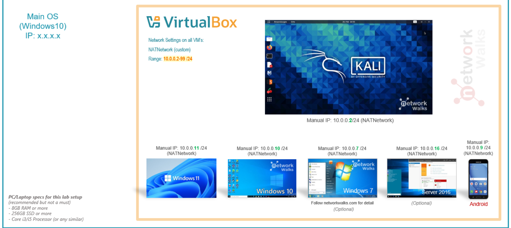
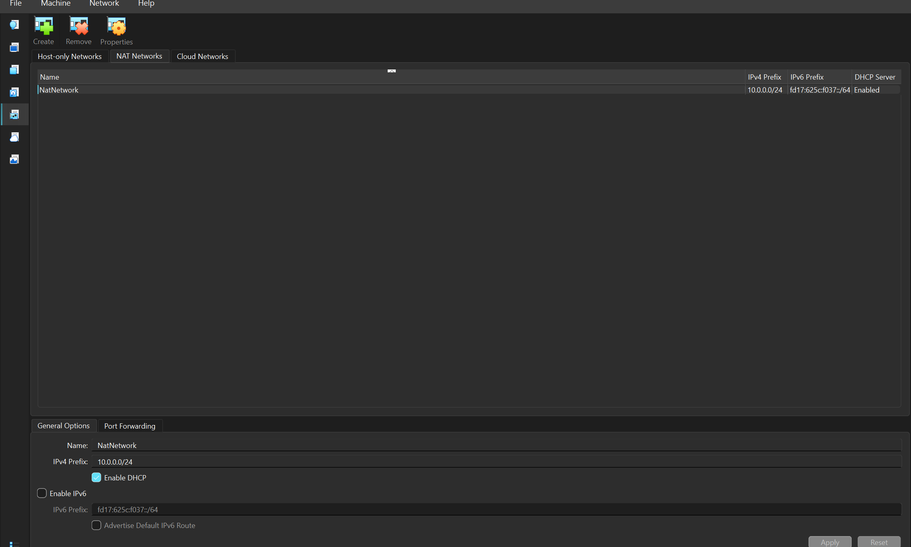
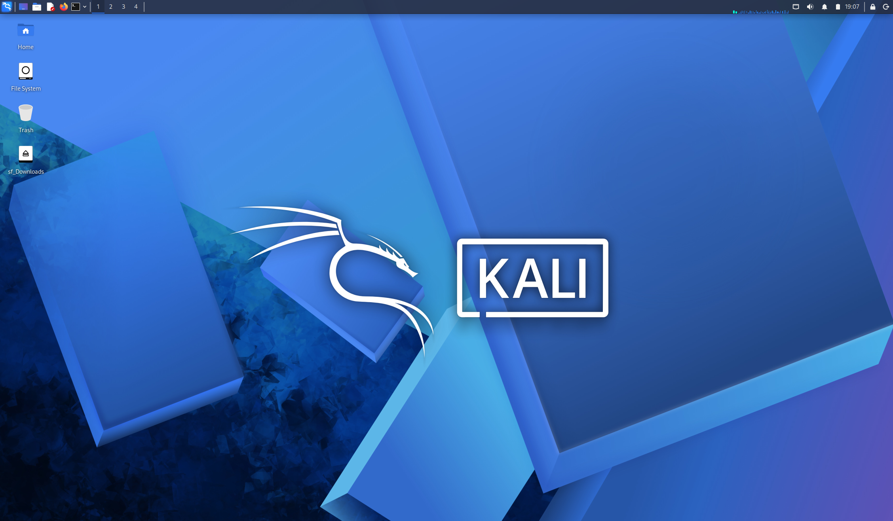
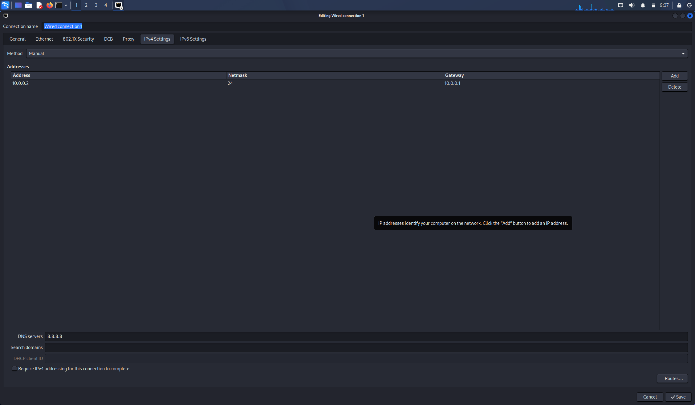

# 🔒 Cybersecurity Lab Environment Setup

Building an isolated virtual lab for penetration testing and ethical hacking practice.

       

---

## 📌 **Project Overview**

This project focuses on **setting up a virtual cybersecurity and penetration-testing laboratory** using **VirtualBox** and **Kali Linux**.

The purpose of the lab is to create a **controlled environment** where cybersecurity tools, network scanning, reconnaissance, vulnerability assessment, and other security-testing activities can be performed safely and repeatedly.

The lab is configured on a **private virtual network** so that additional machines can be added later and used as targets for authorized security testing.



---
## 🎯 **Objectives**

The main objectives of this project are to:
*   **Install and configure VirtualBox.**
*   **Install/import Kali Linux as a virtual machine.**
*   **Create a private NAT Network for the cybersecurity lab.**
*   **Configure network connectivity for Kali Linux.**
*   **Assign a consistent IP address to the Kali VM.**
*   **Verify network connectivity and DNS resolution.**
*   **Take a clean VM snapshot for recovery.**


---
## 🔵 **Purpose of the Lab**

The lab provides an **isolated and controlled environment** for cybersecurity learning and authorized security testing. It can be used for activities such as:
*   **Network reconnaissance**
*   **Port scanning**
*   **Vulnerability assessment**
*   **Packet analysis**
*   **Web security testing**
*   **Exploitation practice**
*   **Security-tool experimentation**

⚠️ **Important:** This laboratory must only be used for systems that you own or have explicit permission to test. Do not use the lab or its tools to attack unauthorized systems.


---
## 🏗️ **Lab Architecture**

### **Hypervisor: VirtualBox**

| 🔧 Component | ⚙️ Configuration |
| :--- | :--- |
| **Host OS** | **Windows 11** |
| **Host RAM** | **8 GB** |
| **Processor** | **Intel Core i7** |
| **Hypervisor** | **VirtualBox 7.2** |
| **Security OS** | **Kali Linux 2026.2** |
| **Kali RAM** | **2048 MB** |
| **Virtual Network** | **NAT Network (`NatNetwork`)** |
| **Network Address** | **`10.0.0.0/24`** |
| **Kali IP Address** | **`10.0.0.2/24`** |
| **Default Gateway** | **`10.0.0.1`** |
| **DNS Server** | **`8.8.8.8`** |


---
## 🛠️ **Lab Setup Procedure**

### **Step 1. Install 7-Zip**
*   **7-Zip** was installed to extract the Kali Linux virtual-machine package, which may be distributed as a **`.7z` archive**.
*   **Tool:** **7-Zip**

### **Step 2. Install VirtualBox**
*   **VirtualBox** was installed as the hypervisor.

### **Step 3. Create the NAT Network**
*   A dedicated **NAT Network** was created in VirtualBox.
*   **Configuration:** 
    *   **Network Name:** `NatNetwork` 
    *   **IPv4 Prefix:** `10.0.0.0/24` 
    *   **DHCP:** `Enabled` 
    *   **IPv6:** `Disabled`



### **Step 4. Import Kali Linux**
*   The **Kali Linux virtual machine** was downloaded from the official Kali Linux website and imported into VirtualBox.
*   The VM network adapter was configured as follows:
    *   **Adapter 1:** Attached to **NAT Network** (`NatNetwork`)
    *   **Adapter Type:** **Intel PRO/1000 MT Desktop**
*   The VM was allocated **2048 MB RAM**.



### **Step 5. Configure the Kali Linux Network**
*   The **Kali Linux network configuration** was checked and configured with a **consistent IPv4 address**.
*   **Example configuration:**
    *   **IP Address:** `10.0.0.2`
    *   **Subnet Mask:** `255.255.255.0`
    *   **Gateway:** `10.0.0.1`
    *   **DNS:** `8.8.8.8`



### **Step 6. Create a Clean VM Snapshot**
*   After completing the initial configuration, a VirtualBox snapshot was created.
*   **Example snapshot name:** **`fresh-Kali - Network Setup`**
*   The snapshot represents the **clean baseline** of the laboratory. If a future exercise changes or damages the VM configuration, the machine can be restored to this baseline.

---

## 🔬 **Lab Verification**

| 🧪 Test | 💻 Command | 🎯 Expected Result |
| :--- | :--- | :--- |
| **Check IP address** | `ip a` | **Correct Kali IP displayed (`10.0.0.2`)** |
| **Test gateway** | `ping 10.0.0.1` | **Successful replies** |
| **Test Internet connectivity** | `ping 8.8.8.8` | **Successful replies** |
| **Test DNS resolution** | `nslookup networkwalks.com` | **Domain resolves** |
| **Verify Nmap** | `nmap --version` | **Nmap version displayed** |
| **Verify snapshot** | Restore snapshot and run `ip a` | **Baseline configuration restored** |

---

## 🐞 **Problems Encountered & Solutions**

### **Problem 1. Internet Connectivity After Static IP Configuration**
After manually configuring the IPv4 settings, internet connectivity may fail depending on the Kali/NetworkManager configuration.

*   **One workaround used during this lab was:**
    ```bash
    sudo nmcli connection modify "Wired connection 1" ipv4.dad-timeout 0
    ```
*   The network connection was then restarted/rebooted and connectivity was tested again.


### **Problem 2. VirtualBox VT-x / Virtualization Error**
The VM initially failed to start because hardware virtualization was disabled in the system firmware/BIOS.

*   **The issue was resolved by:**
    1. **Restarting the computer.**
    2. **Entering BIOS/UEFI settings.**
    3. **Enabling Intel VT-x / hardware virtualization.**
    4. **Saving the configuration.**
    5. **Restarting the computer.**
    6. **Starting the Kali VM again.**

---

## 💡 **What I Learned**

Through this project, I learned how to create and configure a virtual environment for cybersecurity practice. The most important concepts I learned include:

1.  **NAT vs NAT Network**
    *   A standard **NAT configuration** and a **NAT Network** serve different purposes.
    *   A **NAT Network** allows multiple VMs connected to the same virtual network to communicate with one another while providing **network address translation** for external connectivity. This makes it useful for building a **multi-machine cybersecurity laboratory**.
2.  **Virtual Machine Networking**
    *   I learned how **VirtualBox virtual network adapters** connect virtual machines to different types of networks and how network configuration affects communication between machines.
3.  **Static IP Configuration**
    *   I learned how to configure and verify **IPv4 addressing, subnet masks, gateways, and DNS settings** in Kali Linux.
4.  **VM Snapshots**
    *   I learned that a **clean snapshot** should be created before performing risky or experimental activities.
    *   This provides a **known-good recovery point** for future cybersecurity exercises.
5.  **Documentation**
    *   I learned that **documenting commands, configuration, screenshots, problems, and solutions** is an important part of a professional cybersecurity project.

---

## 🛡️ **Security & Ethical Use**

This laboratory is intended strictly for **education purposes only**.

---

## 🔗 **Tools & Resources**

*   **7-Zip:** [7-zip.org/download.html](https://7-zip.org/download.html)
*   **VirtualBox:** [virtualbox.org/wiki/Downloads](https://virtualbox.org/wiki/Downloads)
*   **Kali Linux:** [kali.org/get-kali](https://kali.org/get-kali)

---

## 👤 **Author**

*   **Yvette Ayitey**
*   **Cybersecurity Professional B084D**
*   **LinkedIn:**[https://www.linkedin.com/in/yvette-ayitey-112a29344?utm_source=share_via&utm_content=profile&utm_medium=member_android]

---

## 📌 **Project Information**

Program Name: **Cybersecurity at Networkwalks** | Week: **01** | Project: **Cybersecurity & Pentesting Lab Setup** | Repository: **GitHub**
